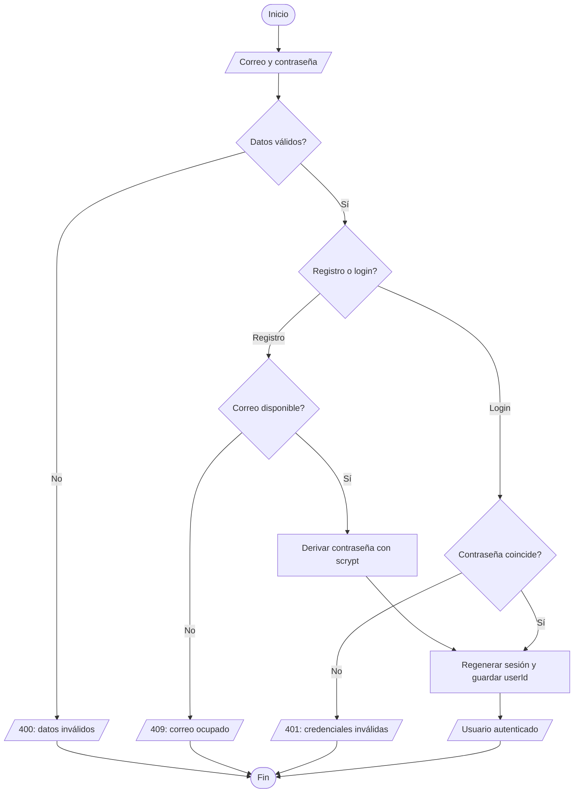

# Base del backend: autenticación y contactos

## Objetivo

Permitir que cada persona cree una cuenta, inicie sesión y posea sus propios contactos sin que otra cuenta pueda acceder a ellos.

## Entradas y salidas

| Operación | Entrada | Salida |
| --- | --- | --- |
| Registro | correo y contraseña de 12–128 caracteres | cuenta y sesión segura |
| Inicio de sesión | correo y contraseña | sesión segura o error genérico |
| Consulta de sesión | cookie `httpOnly` | usuario actual o 401 |

## Restricciones

- El navegador nunca recibe ni guarda el hash de contraseña.
- La sesión se guarda en PostgreSQL y viaja en una cookie `httpOnly`.
- Las contraseñas se derivan con `scrypt`, sal aleatoria y comparación de tiempo constante.
- Registro e inicio están limitados a 10 intentos por IP cada 15 minutos.

## Flujo



## Pseudocódigo

```text
FUNCIÓN AUTENTICAR(datos, modo)
  VALIDAR correo y contraseña
  SI los datos no son válidos ENTONCES RETORNAR error 400
  SI modo ES registro ENTONCES
    SI el correo ya existe ENTONCES RETORNAR error 409
    DERIVAR contraseña con sal aleatoria
    CREAR usuario
  SINO
    BUSCAR usuario por correo
    SI no existe O la contraseña no coincide ENTONCES RETORNAR error 401
  FIN SI
  REGENERAR sesión
  GUARDAR id de usuario en sesión
  RETORNAR usuario autenticado
FIN FUNCIÓN
```

## Prueba de escritorio

| Caso | Entrada | Resultado esperado |
| --- | --- | --- |
| Normal | correo nuevo, contraseña de 12+ caracteres | 201 y cookie de sesión |
| Límite | misma cuenta inicia sesión | 200 y cookie nueva |
| Error | contraseña incorrecta | 401 sin revelar si el correo existe |
