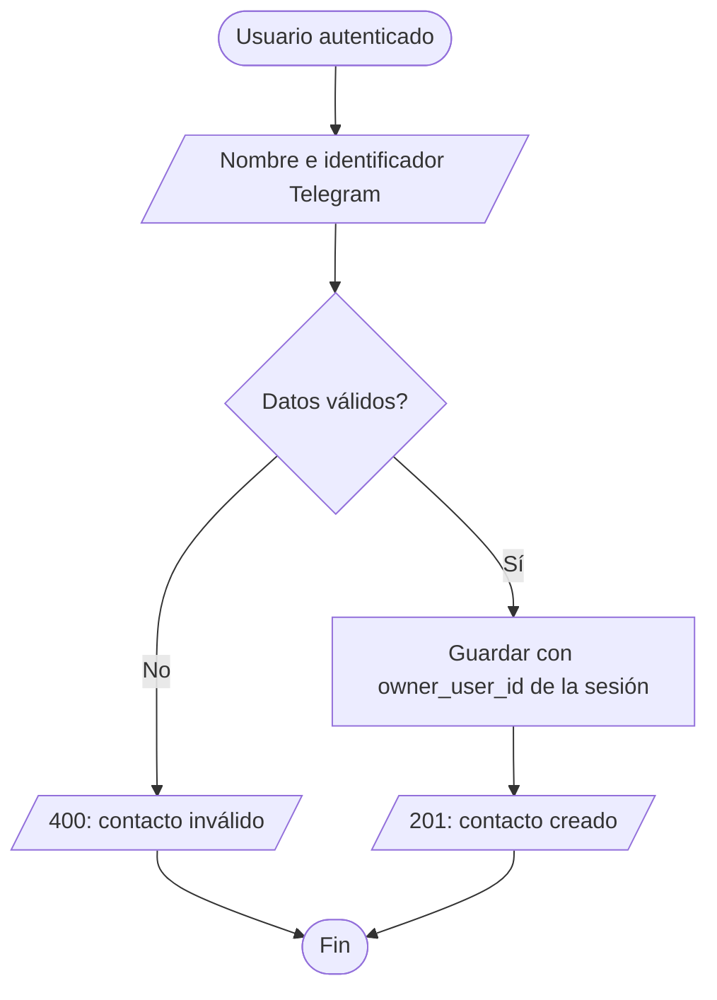

# Contactos: diseño y prueba

## Flujo



## Pseudocódigo

```text
FUNCIÓN CREAR_CONTACTO(datos, sesión)
  SI no existe sesión.userId ENTONCES RETORNAR 401
  VALIDAR nombre y contacto
  SI son inválidos ENTONCES RETORNAR 400
  GUARDAR contacto con owner_user_id = sesión.userId
  RETORNAR contacto creado
FIN FUNCIÓN
```

## Pruebas

| Caso | Resultado esperado |
| --- | --- |
| Sesión válida, nombre y contacto válidos | Crea y lista el contacto solo para ese usuario. |
| Sin sesión | 401, sin revelar contactos. |
| Intento de borrar contacto de otro usuario | 404, sin eliminar datos ajenos. |
