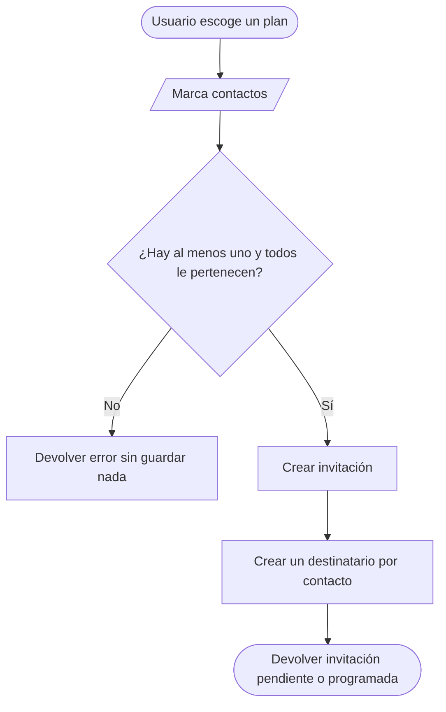

# Invitaciones con varios contactos

## Objetivo

Guardar una invitación de un usuario para uno o varios contactos propios, preparada para que una cola de trabajo la envíe por Telegram después.

## Flujo



## Pseudocódigo

```text
INICIO crear invitación
  LEER protocolo, actividad, fecha opcional y contactos seleccionados
  SI los datos no son válidos ENTONCES devolver error
  SI la fecha existe y no es futura ENTONCES devolver error
  BUSCAR los contactos del usuario actual
  SI falta algún contacto ENTONCES devolver error
  GUARDAR una invitación
  PARA CADA contacto seleccionado
    GUARDAR un destinatario pendiente
  FIN PARA
  DEVOLVER la invitación creada
FIN
```

## Prueba de escritorio

| Caso | Contactos elegidos | Fecha | Resultado esperado |
| --- | --- | --- | --- |
| Normal | Ana y Luis, ambos propios | Ninguna | Una invitación pendiente y dos destinatarios pendientes |
| Programado | Ana, propia | Mañana | Una invitación y un destinatario programados |
| Seguridad | ID de Ana de otra cuenta | Ninguna | Error `recipient_not_found`; no se guarda nada |
