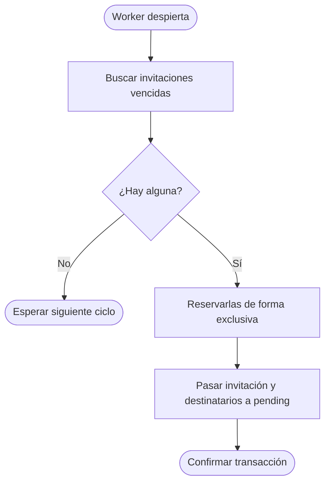

# Cola y worker de invitaciones

## Objetivo

Convertir una invitación programada en una invitación pendiente justo cuando llegue su hora, aunque el navegador esté cerrado.

## Entradas y salidas

| Elemento | Descripción |
| --- | --- |
| Entrada | Invitaciones con `status = scheduled` y `scheduled_at` menor o igual a la hora actual |
| Salida | La invitación y cada destinatario pasan a `pending`, listos para el futuro envío por Telegram |
| Restricción | Un mismo registro no puede ser tomado por dos workers gracias a `FOR UPDATE SKIP LOCKED` |

## Flujo



## Pseudocódigo

```text
FUNCIÓN liberarInvitacionesVencidas(tamañoLote)
  INICIAR TRANSACCIÓN
  BUSCAR hasta tamañoLote invitaciones programadas cuya hora ya llegó
  RESERVAR cada invitación para este worker
  PARA CADA invitación reservada
    CAMBIAR invitación a pendiente
    CAMBIAR sus destinatarios programados a pendientes
  FIN PARA
  CONFIRMAR TRANSACCIÓN
  RETORNAR cantidades procesadas
FIN FUNCIÓN
```

## Prueba de escritorio

| Caso | Hora programada | Hora actual | Resultado |
| --- | --- | --- | --- |
| Normal | 10:00 | 10:01 | Invitación y destinatarios pasan a `pending` |
| Aún temprano | 10:00 | 09:59 | No cambia nada |
| Dos workers | 10:00 | 10:01 | Solo uno reserva y procesa esa invitación |

## Ejecución

```bash
npm run worker
```

Para una única vuelta de comprobación:

```bash
npm run worker:once
```

En producción, el worker debe ejecutarse como un proceso separado de la API.
