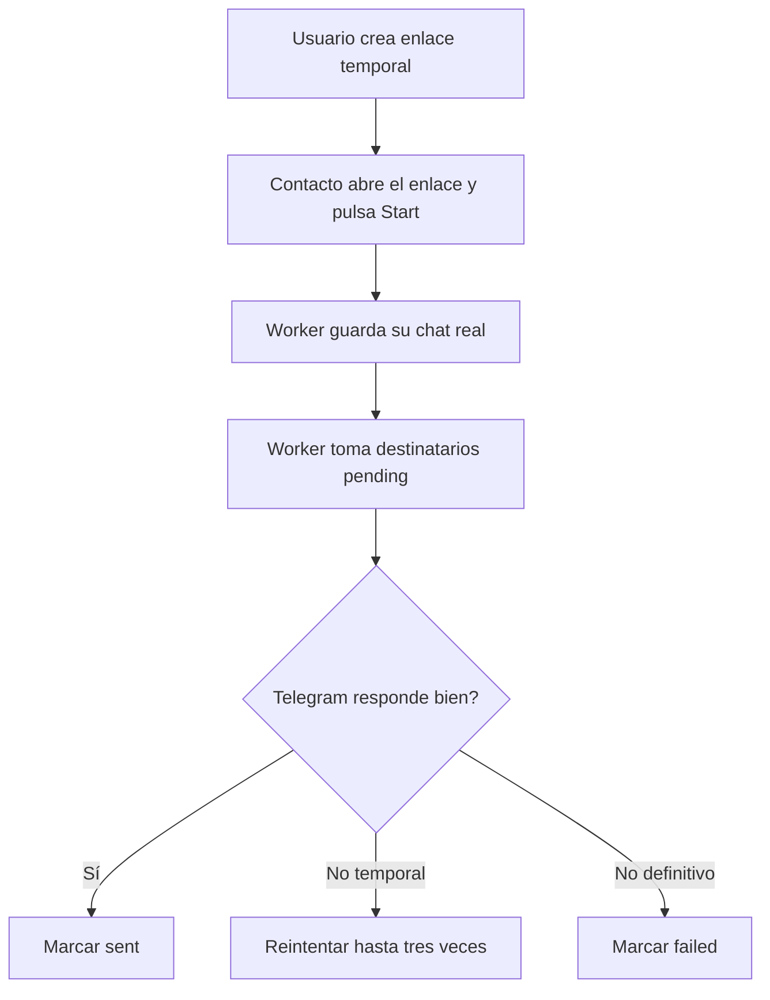

# Telegram: vínculo y entrega

## Flujo

## Reglas

- El enlace de vinculación expira en una hora y solo se puede usar una vez.
- El token del bot se lee únicamente desde `TELEGRAM_BOT_TOKEN`; nunca llega al navegador.
- Cada destinatario se reserva antes de enviar, evitando duplicados entre workers.
- Los errores temporales se reintentan tres veces; los definitivos se registran como fallidos.
